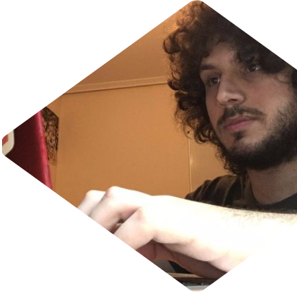

## Hola, soy Santi 🚀

- 😇 Software Engineer
- 📅 Cosas de comunidad en [@asturiaswcraft](https://twitter.com/asturiaswcraft)
- 🟣 "live coding" en http://santi.live 
- 🏀 Jugador de pachangas...
- 🎮 y de videojuegos 
- 🏗 Monto Legos...
- 🛋 y muebles de ikea 
- 📝 Para contactarme utiliza Twitter: [@SantiMA10](https://twitter.com/SantiMA10) ([tengo los MD abiertos!](https://twitter.com/messages/compose?recipient_id=1397520804959694849))

---

## ⭐️ Mis repos con más estrellas

{! repos !}

---

<i>¡Gracias a <a href="https://github.com/midudev" target="_blank"> midudev</a>, <a href="https://github.com/pablosirera" taget="_blank">Pablo Sirera</a> y <a href="https://github.com/carlosazaustre" target="_blank">Carlos Azaustre</a> por la inspiración!</i>

